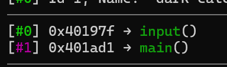
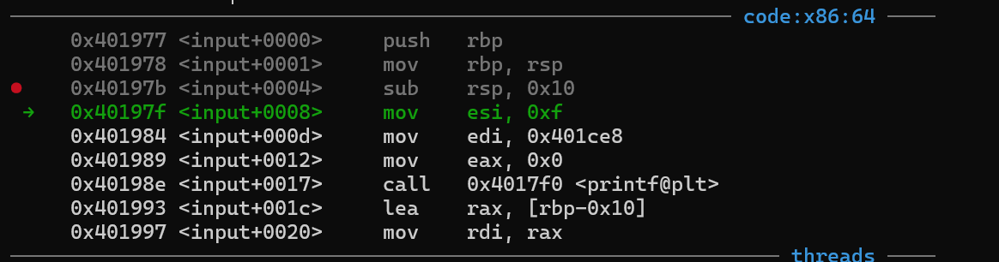
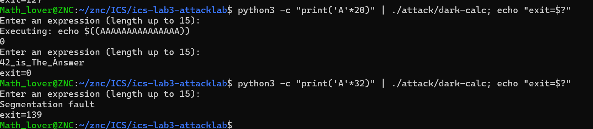

# Lab3 AttackLab 实验报告

| 项目 | 内容 |
| --- | --- |
| 学号 | 26303050167 |
| 日期 | 2026-11-21 |
| 仓库地址 | https://github.com/zouningcan/ics-lab3-attacklab |
| 实验环境 | WSL2（Linux 6.18.33.2-microsoft-standard-WSL2）、GNU GDB 16.3、GEF、GCC 14.2、glibc 2.41 |
| 实验文件 | `attack/dark-calc`、`dark-calc-nx`、`dark-log`、`malware`（文件未修改，SHA-256 校验值与 CI 一致） |

## 一、实验概述

这次实验先用 GDB 看 `input` 的栈帧，弄清楚调用函数时返回地址放在哪里。接着比较不同长度的输入，观察 `gets()` 写出缓冲区后程序会发生什么。后面的任务比较了几个实验程序的运行结果，也用到了 NX、ASLR 和栈保护值（Canary）。

我在本地按 CI 的判定方式检查了任务 2 到任务 5 的输出，结果如下。

| 任务 | 实验程序 | 输出检查 | 退出码 |
| --- | --- | --- | --- |
| 任务 2 | `dark-calc` | PASS | 139 |
| 任务 3 | `dark-calc` | PASS | 139 |
| 任务 4 | `dark-calc-nx` | PASS | 139 |
| 任务 5 | `dark-log` | PASS | 139 |

这四次程序都先打印了要求的字符串，随后因段错误退出。CI 根据标准输出中是否出现指定字符串判定结果，因此退出码为 139 时，输出检查仍显示 PASS。

## 二、任务 0 观察 `input` 的栈帧（20 分）

### 2.1 实验方法

我用 GDB 和 GEF 调试 `attack/dark-calc`。在这次运行中，`b input` 停在 `0x40197b`，此时 `sub rsp, 0x10` 还没执行。我用 `si` 再走一步，到 `0x40197f` 时，函数开头的三条指令都已经执行完了。之后用 `info registers rip rbp rsp` 查看寄存器，用 `x/4gx $rbp` 查看栈上的数据，再用 `bt` 和 `disas main` 对照调用关系。

```text
rip        = 0x40197f
rbp        = 0x721000800fe0
rsp        = 0x721000800fd0
[rbp]      = 0x721000800ff0
[rbp+8]    = 0x401ad1
[rbp+0x10] = 0x0000000000000001
[rbp+0x18] = 0x401c1f
```

### 2.2 问题 1：谁调用了 `input`？

`input` 是由 `main` 直接调用的。回溯里，第 0 帧是 `input`，第 1 帧是 `main`。反汇编里也能看到 `main` 在 `0x401acc` 执行 `call input`。

```text
#0  0x000000000040197f in input ()
#1  0x0000000000401ad1 in main ()
```



### 2.3 问题 2：停下来前的三条指令做了什么？`[rbp]` 的值从哪来？

这三条指令用来建立 `input` 的栈帧。

| 地址 | 指令 | 作用 |
| --- | --- | --- |
| `0x401977` | `push rbp` | 把 `main` 的 `rbp` 压到栈上。 |
| `0x401978` | `mov rbp, rsp` | 让 `rbp` 指向当前栈顶，作为 `input` 的栈帧基址。 |
| `0x40197b` | `sub rsp, 0x10` | 把 `rsp` 往低地址移 16 字节，为局部数组 `expression` 留出空间。 |

因此，`rbp` 现在指向 `input` 的栈帧，而 `[rbp]` 里的 `0x721000800ff0` 是进入 `input` 时保存下来的 `main` 的 `rbp`。



### 2.4 问题 3：`[rbp+8]` 存的是什么？

这里存的是返回地址 `0x401ad1`。我用 `x/gx $rbp+8` 读到这个值，再用 `disas main` 确认它对应 `call input` 后面的那条 `mov eax, 0x0`。`input` 正常返回时，`main` 会从这条指令继续执行。

### 2.5 问题 4：哪条汇编指令写入了这个值？

是 `main` 中的 `call input`。单步执行前，栈顶原有的值是 `0x1`。执行 `call` 后，栈顶变成了 `0x401ad1`。进入 `input` 后，`push rbp` 又压入了 8 字节，接着 `mov rbp, rsp` 确定了新的栈帧基址，所以返回地址位于 `[rbp+8]`。

### 2.6 问题 5：`call`、函数开头的指令、`leave` 和 `ret` 有什么作用？

- `call` 先把下一条指令的地址压栈，再跳到被调用的函数。
- 函数开头的三条指令保存调用者的 `rbp`、建立当前栈帧，并给局部变量留空间。
- `leave` 把 `rsp` 移回栈帧基址，再恢复调用者的 `rbp`。执行完后，栈顶正好是返回地址。
- `ret` 从栈顶取出返回地址，程序从这个地址继续运行。

我从 `leave` 开始单步执行，记录了这三次寄存器的值。

| 时刻 | `rip` | `rbp` | `rsp` |
| --- | --- | --- | --- |
| 执行 `leave` 前 | `0x4019d5` | `0x721000800fe0` | `0x721000800fd0` |
| 执行 `leave` 后 | `0x4019d6` | `0x721000800ff0` | `0x721000800fe8` |
| 执行 `ret` 后 | `0x401ad1` | `0x721000800ff0` | `0x721000800ff0` |

执行 `ret` 后，回溯的第 0 帧变回了 `main`，和 `rip` 的变化一致。

## 三、任务 1 比较不同长度的输入（5 分）

### 3.1 实验方法

我分别记录了输入长度为 20 和 32 个字符时，`dark-calc` 的终端输出和退出码，并在 GDB 里查看读入结束后的栈。



### 3.2 问题 1：两次运行有什么区别？

| 输入长度 | 现象 | 退出码 |
| --- | --- | --- |
| 20 个字符 | 程序输出了计算结果 `0`，并正常退出。 | 0 |
| 32 个字符 | 程序因段错误退出，终端显示 `Segmentation fault`。 | 139 |

20 个字符那次，传给 Bash 的算术表达式里是一个未定义的变量名，所以结果是 `0`。这次是通过管道运行的，标准输出的缓冲会影响提示语出现的顺序。

### 3.3 问题 2：多出来的数据写到了哪里？

`expression` 只有 16 字节，`gets()` 读入时不会按数组大小限制输入。GDB 里可以看到，输入 20 个字符时，数组旁边保存的 `rbp` 已经发生变化，但返回地址还保留着原值。输入 32 个字符时，返回地址也被覆盖了，所以函数返回时发生段错误。两次输入都写出了数组范围，只是影响到的栈内容不同。

## 四、任务 2 利用溢出执行 `./malware`（报告 5 分）

目标是改写 `input` 的返回地址，让程序跳到 `eval` 里直接执行 `system(command_buf)` 的位置，运行同目录的 `./malware`。

`eval` 的反汇编中有两处 `mov edi, 0x6030d0`：第一处后面跟 `strlen`，第二处（`0x401a6b`）后面跟 `call system@plt`。所以返回地址要改成 `0x401a6b`。

payload 的结构如下：

| 偏移 | 内容 | 作用 |
| --- | --- | --- |
| `0x00` – `0x0f` | `"./malware\0"` 加填充 | 写入 `expression`，`strcpy` 会把它复制到 `command_buf` |
| `0x10` – `0x17` | 8 字节填充 | 覆盖 saved rbp |
| `0x18` – `0x1f` | `0x401a6b` 的小端序 | 覆盖返回地址 |

`input` 返回前已经执行 `strcpy(command_buf, expression)`，所以 `command_buf` 里是 `"./malware"`。`ret` 跳到 `0x401a6b` 后，`system("./malware")` 启动脚本；脚本检查祖先进程，确认自己由 `dark-calc` 触发，随后打印 `You have successfully detonated the bomb! Congratulations!`。本地测试的输出检查为 PASS，程序随后因段错误退出（退出码 139）。

## 五、任务 3a 检查 `main` 的机器码（5 分）

### 5.1 实验方法

我先用 `disas main` 找到 `main` 的起始地址，再用 `x/16xb 0x401ac3` 按字节查看内存，把前几条指令和它们对应的字节对起来。

### 5.2 问题 1：前三条指令对应哪些字节？

| 指令 | 机器码 | 字节数 | 地址区间 |
| --- | --- | --- | --- |
| `push rbp` | `55` | 1 | `0x401ac3` |
| `mov rbp, rsp` | `48 89 e5` | 3 | `0x401ac4` 至 `0x401ac6` |
| `mov eax, 0x0` | `b8 00 00 00 00` | 5 | `0x401ac7` 至 `0x401acb` |

### 5.3 问题 2：这些字节在内存里怎么排？

这三条指令连续存放，中间没有空隙。逐条执行时，`rip` 依次是 `0x401ac3`、`0x401ac4`、`0x401ac7` 和 `0x401acc`。相邻地址分别差 1、3 和 5 字节，正好对应这三条指令各自的长度。

### 5.4 相对偏移的小端序

`call input` 的机器码为 `e8 a6 fe ff ff`。其中 `e8` 是操作码，后面四个字节按小端序读为 `0xfffffea6`，作为有符号数是 `-0x15a`。把偏移加到下一条指令的地址 `0x401ad1` 上，得到 `0x401977`，也就是 `input` 的入口。

## 六、任务 3 在栈上执行 shellcode（报告 5 分）

`dark-calc` 在进入 `main` 前切换到了实验程序自己映射的栈。`init_fixed_stack` 在固定地址 `0x721000000000` 附近映射了一块可读、可写、可执行的区域，`__wrap_main` 把 `rsp` 切到 `0x721000801000`。因此在 `input` 里，`expression` 的地址固定为 `0x721000800fd0`，不需要考虑 ASLR。

目标仍然是调用 `grade_eval(4)`。把下面三条指令汇编成机器码，放进 `expression`：

```asm
mov edi, 4              ; bf 04 00 00 00
mov eax, 0x401a87       ; b8 87 1a 40 00
call rax                ; ff d0
```

payload 的前 16 字节是这 12 字节 shellcode 加 4 个 NOP，接着 8 字节填 saved rbp，最后 8 字节把返回地址改成 `0x721000800fd0`。`input` 的 `ret` 跳到缓冲区开头，依次执行 `mov edi,4`、`mov eax,grade_eval`、`call rax`，`grade_eval(4)` 打印 `Hope A will be your grade!`。本地测试的输出检查为 PASS；shellcode 返回后程序可能因继续执行填充字节而段错误。

## 七、任务 4 用 ROP 调用 `grade_eval`（10 分）

`dark-calc-nx` 的 `GNU_STACK` 标记为 `RW`，栈可以读写，但不能执行；实验里还观察到栈地址随运行变化。这个版本的主程序未启用 PIE，代码段地址保持固定。NX 管的是内存页能不能执行，ASLR 管的是地址会不会随运行变化。

栈上 shellcode 和硬编码栈地址都被阻止了，但 `.text` 里的指令片段仍然可用。我在 `__libc_csu_init` 附近找到一条错位 gadget：

```asm
0x401a32: 41 5f    pop r15
0x401a34: c3       ret
```

从 `0x401a33` 开始读，就是 `5f c3`，即 `pop rdi; ret`。`grade_eval` 的地址是 `0x401978`。

payload 的结构：

| 偏移 | 内容 | 作用 |
| --- | --- | --- |
| `0x00` – `0x0f` | 16 字节填充 | `expression` |
| `0x10` – `0x17` | 8 字节填充 | saved rbp |
| `0x18` – `0x1f` | `0x401a33` | `pop rdi; ret` |
| `0x20` – `0x27` | `4` | 弹进 `rdi` 的参数 |
| `0x28` – `0x2f` | `0x401978` | `grade_eval` |

`input` 的 `ret` 先跳到 `pop rdi; ret`，把 4 弹进 `rdi`，再跳到 `grade_eval`；`grade_eval(4)` 打印 `Hope A will be your grade!`。本地测试的输出检查为 PASS。这条链在本机 glibc 上没有触发栈对齐问题；如果换一个版本在 `printf` 的 `movaps` 处崩溃，可以在链的最前面加一个单独的 `ret`（`0x401a34`）把 `rsp` 再移动 8 字节。

## 八、任务 5 绕过栈保护值（10 分）

### 8.1 结构体布局与保护值

`dark-log` 启用了栈保护。`input` 的局部变量是一个结构体：

```c
struct log_frame {
  char expression[128];
  char logMsg[128];
  int len;
  char pad[8];
};
```

栈上的布局（相对 `expression` 起点）：

| 偏移 | 内容 |
| --- | --- |
| `0x000` – `0x07f` | `expression` |
| `0x080` – `0x0ff` | `logMsg` |
| `0x100` – `0x103` | `len` |
| `0x118` – `0x11f` | 保护值（canary） |
| `0x128` – `0x12f` | 返回地址 |

直接覆盖返回地址会先踩到保护值，程序会报错并终止。

### 8.2 绕过思路

`input` 里先 `gets(f.expression)`，再 `memcpy(f.logMsg + f.len, f.expression, sizeof(f.expression))`。`gets` 不检查长度，而 `len` 位于 `expression` 之后 `0x100` 字节处；只要输入 `0x104` 字节，就能把 `len` 改成 `0xa8`，同时不碰到偏移 `0x118` 的保护值。

此时 `memcpy` 的目标是 `logMsg + 0xa8 = rbp + 8`，正好是返回地址。`memcpy` 会把 `expression[0..127]` 复制到保护值上方的返回地址区域，保护值保持不变，函数返回前的校验通过。

复制的链条是：

| 偏移 | 内容 |
| --- | --- |
| `0x00` | `pop rdi; ret`（`0x4018a3`） |
| `0x08` | `4` |
| `0x10` | `grade_eval`（`0x401677`） |

`input` 的 `ret` 跳到 `pop rdi; ret`，把 4 弹进 `rdi`，再跳到 `grade_eval`，打印 `Hope A will be your grade!`。本地测试的输出检查为 PASS，终端没有出现 `stack smashing detected`。

### 8.3 怎样减少这类问题？

这个攻击依赖两个条件同时成立：`len` 位于 `expression` 的高地址方向，能被 `gets` 的溢出改写；保护值位于 `len` 之后，所以改 `len` 时还碰不到它。

因此可以这样调整布局：

- 把 `len` 放到 `expression` 之前（更低的地址）。`gets` 向高地址写，无法回头改到 `len`；
- 把 `expression`、`logMsg` 等缓冲区放到靠近保护值的高地址，这样任何向返回地址方向的溢出都会先覆盖保护值；
- 或者不要把长度存在栈上：改用固定偏移 `memcpy(f.logMsg, f.expression, 128)`，或把 `len` 放在寄存器/只读位置，并对 `len` 做边界检查。

更直接的改法是先限制读入长度，再检查复制的源范围、目标范围和字节数。目标位置如果包含偏移，还要先确认偏移本身在目标缓冲区内，再根据剩余空间限制复制长度。

为什么这样能防住：本攻击的核心是“改长度但不碰保护值”。如果 `len` 在缓冲区低地址，第一步就无法完成；如果缓冲区紧邻保护值，第一步就会先触发保护值校验。两者都能让 `memcpy` 的目标停留在 `logMsg`，无法到达返回地址。

## 九、ASLR 实验

我编译了 `src/aslr.c`，连续运行了五次。

```bash
gcc -o /tmp/aslr src/aslr.c
for i in 1 2 3 4 5; do /tmp/aslr; done
```

本机的 `randomize_va_space` 为 `2`，五次打印出的地址如下。

```text
0x7ffefdb4d54c
0x7ffec1a8cf7c
0x7ffd86b02d6c
0x7ffeebbd51fc
0x7fff36b96dbc
```

同一个局部变量 `i` 在五次运行中的地址都不同，说明在这组实验里，栈地址会随运行变化。GDB 的随机化设置也会影响观察结果，比较地址前要先确认是不是在调试器里启动的程序。

## 十、总结与防御思考

我在任务 1 里看到，程序即使正常退出，局部数组旁边的栈数据也可能已经被改写。通过 GDB 对照 `call`、`leave` 和 `ret` 前后的寄存器，再结合任务 3a 里看到的机器码，能把正常的函数返回和发生段错误时的情况对应起来。

| 防护 | 在这次实验里观察到的作用 |
| --- | --- |
| NX | `dark-calc-nx` 和 `dark-log` 使用不可执行的栈。 |
| ASLR | 多次运行 `src/aslr.c` 时，局部变量的地址发生变化。 |
| PIE | 主程序启用 PIE 后，代码段也可以随运行随机化。本实验的目标程序未启用 PIE。 |
| 栈保护值 | `dark-log` 在函数返回前检查栈保护值，以发现一部分栈破坏。 |
| 输入及复制边界检查 | 用带长度限制的函数读入数据，并在复制前核对范围，可以防止数据写出缓冲区。 |

这几种防护管的是不同环节。对这次实验涉及的程序来说，应该先限制输入长度，并检查后续复制的边界，再用编译和运行时防护减轻出错后的影响。
